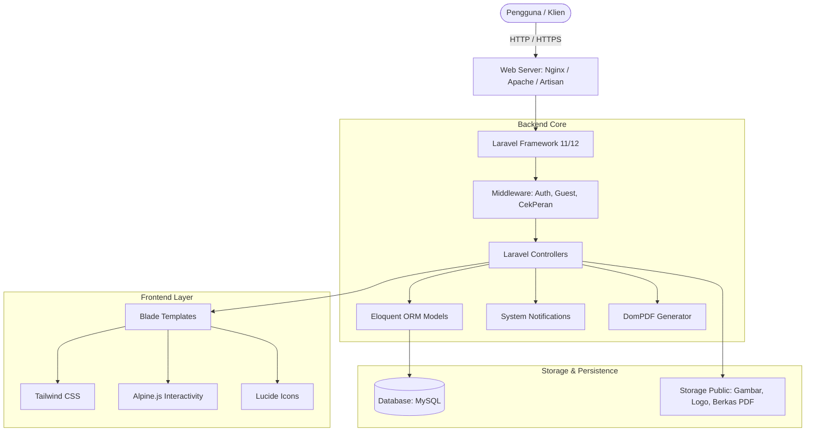

# SIMORA FST - Sistem Informasi Manajemen Operasional Ruang & Alat
### Fakultas Sains dan Teknologi — Universitas Islam Negeri (UIN) Imam Bonjol Padang

[](https://laravel.com)
[](https://php.net)
[](https://mysql.com)
[](https://tailwindcss.com)
[](https://alpinejs.dev)
[](LICENSE)

**SIMORA FST** adalah platform sistem informasi berbasis web terintegrasi yang dirancang khusus untuk memodernisasi dan mengotomatisasi tata kelola peminjaman sarana dan prasarana akademik di lingkungan Fakultas Sains dan Teknologi, UIN Imam Bonjol Padang. Sistem ini menggantikan birokrasi manual berbasis formulir fisik menjadi alur kerja digital yang transparan, real-time, akuntabel, dan bebas dari konflik jadwal tumpang tindih (*double-booking*).

---

## Daftar Isi
- [Latar Belakang & Tujuan](#latar-belakang--tujuan)
- [Fitur Utama Sistem](#fitur-utama-sistem)
- [Peran Pengguna (Multi-Role)](#peran-pengguna-multi-role)
- [Arsitektur & Tumpukan Teknologi (Tech Stack)](#arsitektur--tumpukan-teknologi-tech-stack)
- [Persyaratan Sistem (Prerequisites)](#persyaratan-sistem-prerequisites)
- [Panduan Instalasi & Menjalankan Proyek](#panduan-instalasi--menjalankan-proyek)
- [Kredensial Default untuk Pengujian](#kredensial-default-untuk-pengujian)
- [Struktur Direktori Proyek](#struktur-direktori-proyek)
- [Dokumentasi Pengujian (QA & Black Box Testing)](#dokumentasi-pengujian-qa--black-box-testing)
- [Lisensi](#lisensi)

---

## Latar Belakang & Tujuan
Sebelum adanya SIMORA, koordinasi peminjaman ruang perkuliahan, laboratorium komputer, aula pertemuan, dan perangkat presentasi/elektronik di FST UINIB kerap menghadapi tantangan:
1. Ketidakpastian ketersediaan jadwal ruangan secara *real-time*.
2. Risiko bentrok jadwal antar-kegiatan mahasiswa dan dosen (*human error*).
3. Kerumitan pengarsipan dokumen surat izin dan berita acara pengembalian aset.
4. Kurangnya visibilitas pimpinan terhadap statistik utilisasi sarana kampus.

**SIMORA FST** hadir menjawab tantangan tersebut dengan menghadirkan visualisasi jadwal timeline interaktif, validasi bentrok jadwal otomatis pada tingkat aplikasi, alur persetujuan berbasis notifikasi, serta rekam jejak audit (*audit trail*) yang komprehensif.

---

## Fitur Utama Sistem

### 1. Beranda Publik & Matriks Jadwal Realtime (Tanpa Login)
- **Ringkasan Metrik Fasilitas:** Menampilkan total ruangan, peralatan, dan fasilitas tersedia secara *live*.
- **Matriks Timeline Jadwal Gantt Chart:** Visualisasi penggunaan jam operasional (07:00 – 21:00 WIB) setiap ruangan per hari dengan pembagian layer pintar sehingga peminjaman tidak saling menimpa.
- **Kalender Interaktif Ketersediaan:** Menampilkan jadwal kegiatan yang disetujui dalam tampilan kalender bulanan.
- **Pencarian Cepat (*Live Search*):** Mencari fasilitas berdasarkan nama, kode inventaris, atau kategori.

### 2. Autentikasi, Registrasi & Pemulihan Akun
- **Multi-Identifier Login:** Mendukung login menggunakan alamat Email resmi maupun Nomor Identitas (NIM Mahasiswa / NIP Dosen).
- **Alur Registrasi Berbeda per Tipe Pengguna:**
  - *Mahasiswa:* Akun langsung aktif setelah pendaftaran.
  - *Dosen:* Akun berstatus `menunggu` dan memerlukan persetujuan (*approval*) dari Super Admin demi validasi institusional.
- **Pemulihan Kata Sandi via OTP Email:** Pengiriman 6 digit kode OTP verifikasi dengan batas kedaluwarsa 15 menit, proteksi *session-lock*, dan mekanisme kirim ulang (*resend OTP*).
- **Pengaturan Profil Mandiri:** Pengguna dapat memperbarui data akun serta mengganti kata sandi baik melalui verifikasi kata sandi lama maupun via OTP email.

### 3. Katalog Fasilitas Terpadu (Pengguna)
- **Katalog Ruangan:** Filter kategori dinamis (Aula, Ruang Kuliah, Lab Komputer, dll.), filter ketersediaan tanggal, dan pengurutan (A-Z, Z-A, Terbaru, Terlama).
- **Detail Ruangan & Galeri Multi-Foto:** Menampilkan kapasitas orang, lokasi gedung/lantai, fasilitas pendukung, galeri hingga 3 foto berkualitas tinggi, serta slot jam terpakai pada tanggal yang dipilih.
- **Katalog Alat / Elektronik:** Menampilkan ketersediaan alat (Infocus/Proyektor, Sound System, Kabel HDMI) beserta informasi peminjaman langsung di loket operasional.

### 4. Pengajuan & Manajemen Peminjaman Ruangan
- **Deteksi Bentrok Jadwal Realtime (AJAX):** Sistem mengecek ketersediaan jam dan tanggal sebelum formulir dikirimkan serta menampilkan daftar jadwal terisi pada hari yang sama.
- **Pencegahan Double-Booking Ganda:** Validasi backend tingkat lanjut melalui method `tersediaPadaWaktu()` yang mencegah peminjaman beririsan jam.
- **Upload Surat/Berkas Persyaratan:** Mendukung unggah berkas izin resmi format PDF (maksimal 5MB) yang tersimpan aman di storage server.
- **Pelacakan Status & Pembatalan:** Memantau status pengajuan (`menunggu`, `disetujui`, `ditolak`, `selesai`). Pengguna dapat membatalkan pengajuan secara mandiri selama status masih `menunggu`.
- **Riwayat Lengkap Peminjaman:** Arsip transaksi masa lalu dengan filter status, filter bulan, dan pencarian kata kunci.

### 5. Input Langsung oleh Admin (Loket Fasilitas)
- **Peminjaman Alat Langsung di Loket:** Admin dapat langsung memproses peminjaman alat untuk mahasiswa/dosen aktif dengan status langsung `disetujui` (berjalan) dan memproteksi alat yang sedang belum dikembalikan.
- **Input Jadwal Ruangan Akademik:** Admin dapat menginputkan jadwal perkuliahan atau agenda pimpinan langsung ke kalender dengan proteksi deteksi bentrok jadwal.

### 6. Verifikasi & Pengembalian Aset
- **Verifikasi Pengajuan:** Admin dapat meninjau berkas PDF pemohon, lalu menyetujui atau menolak dengan mencantumkan alasan penolakan wajib. Notifikasi otomatis dikirimkan ke peminjam.
- **Pengembalian & Berita Acara:** Admin memproses pengembalian dengan mencatat kondisi akhir (`baik`, `rusak`, `hilang`) dan catatan pemeriksaan.
- **Otomatisasi Status Fisik Fasilitas:** Jika fasilitas dilaporkan *rusak* atau *hilang*, sistem secara otomatis mengubah status fisik fasilitas menjadi `perbaikan` agar tidak dapat dipesan pengguna lain.

### 7. Manajemen Fasilitas & Kategori (CRUD)
- Kelola data ruangan dan peralatan lengkap dengan kode inventaris auto-generate (`RNG-xxxxx` / `ALT-xxxxx`), kapasitas, jumlah unit, deskripsi, serta upload foto utama dan galeri pendukung.
- Fitur penambahan kategori baru secara instan langsung dari modal tambah fasilitas.
- Manajemen kategori fasilitas terpisah dengan penghitungan akumulasi jumlah fasilitas terkait.

### 8. Laporan, Visualisasi & Cetak PDF Resmi
- **Dashboard Laporan Admin:** Ringkasan statistik, grafik perbandingan utilisasi ruangan vs alat, dan ringkasan fasilitas terfavorit.
- **Ekspor Dokumen PDF Cetak:** Men-generate laporan transaksi peminjaman berformat PDF landscape A4 siap cetak via *DomPDF*, lengkap dengan kop surat resmi, filter rentang tanggal, filter status, dan tanda tangan cetak.
- **Laporan Eksekutif Super Admin:** Analisis tren peminjaman 12 bulan (Januari–Desember) per tahun, diagram persentase donat, dan tabel transaksi terkini.

### 9. Manajemen Pengguna & Persetujuan Dosen (Super Admin)
- Antarmuka tabbed cerdas mengelompokkan akun Admin, Mahasiswa, Dosen Aktif, Dosen Menunggu Konfirmasi, dan Pengguna Lainnya.
- Penyetujuan (*approval*) akun dosen baru dengan satu klik.
- Pembuatan akun Admin baru dan aktivasi/nonaktif akun.
- Proteksi keamanan: Akun berstatus Super Admin tidak dapat dihapus oleh pengguna manapun.

### 10. Audit Log & Evaluasi Layanan
- **Audit Trail:** Mencatat seluruh tindakan penting (login, logout, tambah/edit fasilitas, persetujuan, pembatalan, reset sandi) lengkap dengan alamat IP pengguna dan waktu kejadian.
- **Evaluasi Feedback:** Pengguna dapat memberikan rating bintang 1–5 dan saran layanan. Super Admin dapat memantau rata-rata kepuasan layanan secara teragregasi.

### 11. Pengaturan Identitas & Branding Website Dinamis
- Super Admin dapat mengubah Nama Website, Sub-Nama, Deskripsi, Kontak Email, Telepon, Alamat Kampus, dan Warna Aksen Tema (Color Picker HEX).
- Fitur ganti Logo Website (maksimal 2MB) dan Favicon (maksimal 1MB) dengan sistem penghapusan aset lama otomatis serta *fallback* aset default yang aman.

---

## Peran Pengguna (Multi-Role)

| Peran | Hak Akses & Tanggung Jawab |
| :--- | :--- |
| **Guest (Publik)** | Melihat beranda, kalender interaktif, matriks jadwal ketersediaan, katalog fasilitas, halaman login, registrasi, dan lupa sandi. |
| **Pengguna (Mahasiswa/Dosen)** | Mengajukan peminjaman ruangan online, cek ketersediaan jam realtime, melacak status peminjaman, membatalkan pengajuan menunggu, melihat riwayat transaksi, memberikan feedback ulasan, dan mengelola profil akun. |
| **Admin (Pengelola Fasilitas)** | Mengelola data ruangan, alat, dan kategori; menginput peminjaman alat loket; menginput jadwal ruangan; memverifikasi pengajuan (setujui/tolak); memproses pengembalian fasilitas & kondisi akhir; memantau riwayat global; dan mencetak laporan transaksi PDF. |
| **Super Admin (Pimpinan / Dekanat)** | Memiliki seluruh wewenang Admin ditambah: menyetujui akun Dosen baru; mengelola seluruh akun pengguna/admin; memantau dashboard eksekutif tahunan; mengakses audit log aktivitas sistem; meninjau evaluasi feedback; dan mengubah konfigurasi branding/identitas website. |

---

## Arsitektur & Tumpukan Teknologi (Tech Stack)



- **Backend:** PHP 8.3+, Laravel Framework (MVC Architecture)
- **Database:** MySQL / MariaDB (Relational DBMS)
- **Frontend:** Laravel Blade Templating, Tailwind CSS v3, Alpine.js v3, Lucide Icons
- **Dokumen Generator:** `barryvdh/laravel-dompdf` (Rendering PDF Landscape A4)
- **Keamanan:** CSRF Protection, Password Hashing (Bcrypt/Argon2), Prepared Statements (SQL Injection Prevention), XSS Sanitization, Role-Based Access Control (RBAC), IDOR Protection.

---

## Persyaratan Sistem (Prerequisites)
Sebelum menjalankan aplikasi, pastikan komputer atau server telah terpasang:
- **PHP** versi `>= 8.2` (Sangat disarankan **PHP 8.3**)
  - Ekstensi PHP aktif: `OpenSSL`, `PDO`, `Mbstring`, `Tokenizer`, `XML`, `Ctype`, `JSON`, `BCMath`, `Fileinfo`, `GD`
- **Composer** versi `>= 2.2`
- **MySQL Server** versi `>= 8.0` atau **MariaDB** versi `>= 10.4`
- **Web Server:** Apache (via Laragon / XAMPP) atau Nginx
- **Browser:** Google Chrome, Mozilla Firefox, Microsoft Edge, atau Safari modern

---

## Panduan Instalasi & Menjalankan Proyek

### 1. Clone Repository
```bash
git clone https://github.com/username-anda/simora-fst-uinib.git
cd simora-fst-uinib
```

### 2. Pasang Dependensi Composer
```bash
composer install
```

### 3. Konfigurasi File Lingkungan (`.env`)
Salin file `.env.example` menjadi `.env`:
```bash
cp .env.example .env
```
Sesuaikan konfigurasi koneksi database MySQL pada file `.env`:
```env
APP_NAME="SIMORA FST"
APP_ENV=local
APP_KEY=
APP_DEBUG=true
APP_URL=http://127.0.0.1:8000

DB_CONNECTION=mysql
DB_HOST=127.0.0.1
DB_PORT=3306
DB_DATABASE=peminjaman_fst_uinib
DB_USERNAME=root
DB_PASSWORD=
```

### 4. Generate Application Key
```bash
php artisan key:generate
```

### 5. Hubungkan Direktori Storage Publik
Perintah ini wajib dijalankan agar file foto fasilitas, logo website, dan berkas persyaratan peminjaman dapat diakses dari browser:
```bash
php artisan storage:link
```

### 6. Jalankan Migrasi Database & Seeder
Buat seluruh tabel dan isi data awal (*dummy data*) yang diperlukan:
```bash
php artisan migrate:fresh --seed
```

### 7. Jalankan Server Pengembangan Lokal
```bash
php artisan serve
```
Aplikasi kini dapat diakses melalui browser pada alamat: **`http://127.0.0.1:8000`**.

---

## Kredensial Default untuk Pengujian

Setelah menjalankan `php artisan migrate:fresh --seed`, Anda dapat menggunakan akun berikut untuk menguji masing-masing peran:

| Peran | Alamat Email | Kata Sandi | Keterangan |
| :--- | :--- | :--- | :--- |
| **Super Admin** | `superadmin@fst-uinib.ac.id` | `password` | Akun pimpinan tertinggi dengan akses penuh ke seluruh modul sistem |
| **Admin Fasilitas** | `siti@gmail.com` | `password` | Akun pengelola sarana dan loket peminjaman |
| **Dosen (Aktif)** | `ahmad@fst.uinib.ac.id` | `password` | Akun dosen dengan hak akses katalog dan pengajuan |
| **Mahasiswa** | `budi@fst.uinib.ac.id` | `password` | Akun mahasiswa (NIM: `2014020001`) untuk pengujian peminjaman ruang |

---

## Struktur Direktori Proyek

```text
├── app/
│   ├── Http/
│   │   ├── Controllers/
│   │   │   ├── AuthController.php          # Login, registrasi, logout
│   │   │   ├── BerandaController.php       # Beranda publik, kalender, matriks jadwal, katalog
│   │   │   ├── DashboardController.php     # Logika dashboard multi-role (Pengguna, Admin, Super Admin)
│   │   │   ├── FasilitasController.php     # Manajemen ruangan, alat, dan kategori
│   │   │   ├── LaporanController.php       # Laporan admin, eksekutif, dan ekspor DomPDF
│   │   │   ├── LupaSandiController.php     # Alur lupa sandi dan verifikasi OTP email
│   │   │   ├── NotifikasiController.php    # Manajemen notifikasi sistem
│   │   │   ├── PeminjamanController.php    # Alur pengajuan, jadwal ruangan, pembatalan, verifikasi
│   │   │   ├── PengaturanController.php    # Konfigurasi identitas website, logo, dan favicon
│   │   │   ├── PengembalianController.php  # Pemrosesan pengembalian fasilitas dan kondisi fisik
│   │   │   ├── PenggunaController.php      # Manajemen pengguna dan audit log aktivitas
│   │   │   ├── ProfilController.php        # Profil akun dan penggantian kata sandi mandiri
│   │   │   └── UlasanController.php        # Pengiriman dan rekapitulasi evaluasi feedback
│   │   └── Middleware/
│   │       └── CekPeran.php                # Proteksi otorisasi peran (RBAC Middleware)
│   └── Models/
│       ├── Fasilitas.php                   # Model fasilitas (ruangan & alat) + conflict checking
│       ├── KategoriFasilitas.php           # Model kategori fasilitas
│       ├── LogAktivitas.php                # Model audit trail log aktivitas
│       ├── Peminjaman.php                  # Model transaksi peminjaman sarana
│       ├── Pengaturan.php                  # Model key-value pengaturan website
│       ├── Pengembalian.php                # Model berita acara pengembalian aset
│       ├── Pengguna.php                    # Model pengguna & autentikasi
│       └── UlasanLayanan.php               # Model feedback & rating kepuasan
├── database/
│   ├── migrations/                         # Skema database relasional
│   └── seeders/                            # Data awal sistem dan user demo
├── resources/
│   └── views/
│       ├── admin/                          # Tampilan modul pengelola fasilitas
│       ├── auth/                           # Tampilan login, registrasi, lupa sandi, OTP
│       ├── emails/                         # Template email pengiriman kode OTP
│       ├── pengguna/                       # Tampilan modul mahasiswa & dosen (katalog, status, dll)
│       ├── profil/                         # Tampilan pengaturan profil akun
│       ├── super_admin/                    # Tampilan modul pimpinan (log, pengguna, pengaturan)
│       └── beranda.blade.php               # Halaman utama publik
├── routes/
│   └── web.php                             # Definisi seluruh rute web dan pengelompokan middleware
└── storage/                                # Direktori penyimpanan berkas PDF, logo, dan galeri foto
```

---

## Dokumentasi Pengujian (QA & Black Box Testing)
Sistem ini telah melewati audit komprehensif menggunakan metodologi **Black Box Testing** dengan tingkat kelulusan **100% Valid**:
- **Total Skenario Uji:** 160 Kasus Uji Menyeluruh
- **Cakupan Rute:** 100% Terpetakan (76 Endpoint Rute HTTP: GET, POST, PUT, DELETE)
- **Metode Pengujian:** *Equivalence Partitioning*, *Boundary Value Analysis*, *State Transition Testing*, dan *Insecure Direct Object Reference (IDOR) Access Control Testing*.

Dokumen laporan pengujian format Microsoft Word (`.docx`) siap cetak telah tersedia di dalam repositori:
📄 **[DOKUMEN_PENGUJIAN_BLACKBOX_SIMORA_FST.docx](DOKUMEN_PENGUJIAN_BLACKBOX_SIMORA_FST.docx)**

---

## Lisensi
Proyek SIMORA FST ini dikembangkan untuk keperluan akademik dan manajemen sarana Fakultas Sains dan Teknologi UIN Imam Bonjol Padang serta didistribusikan di bawah lisensi terbuka [MIT License](LICENSE).
